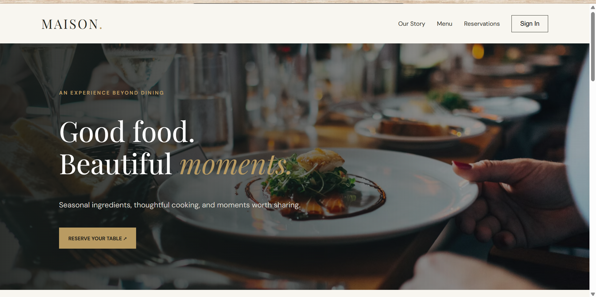
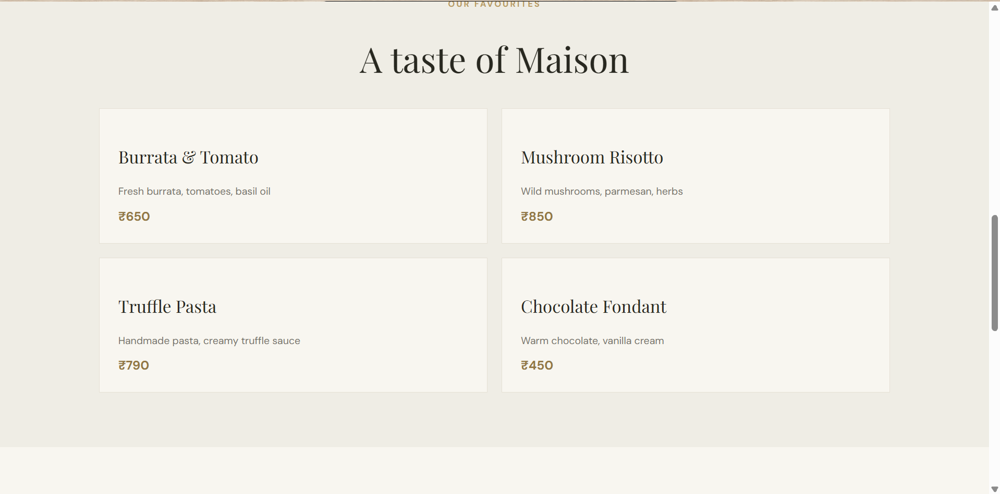
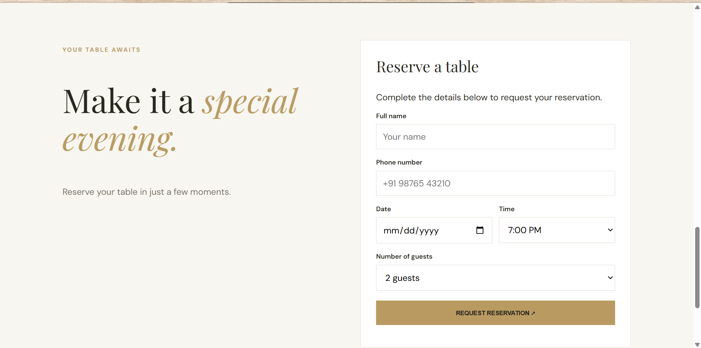
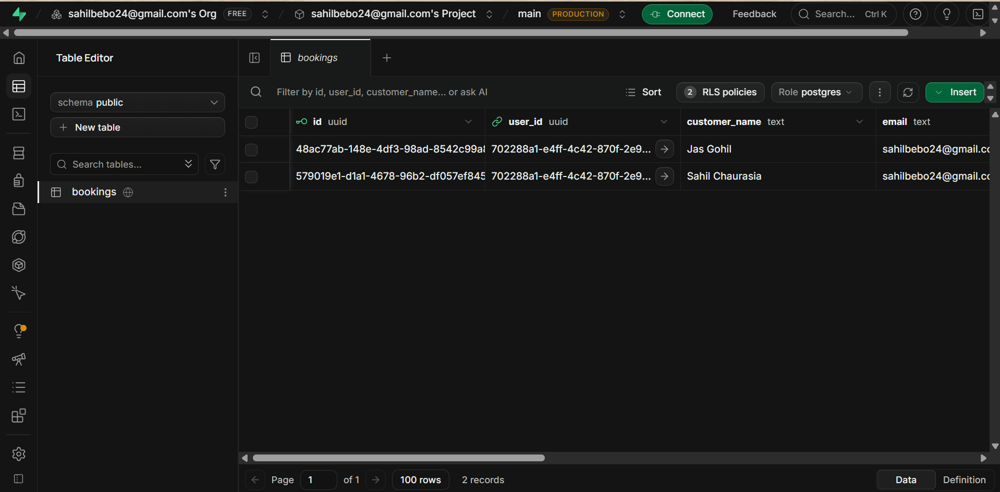
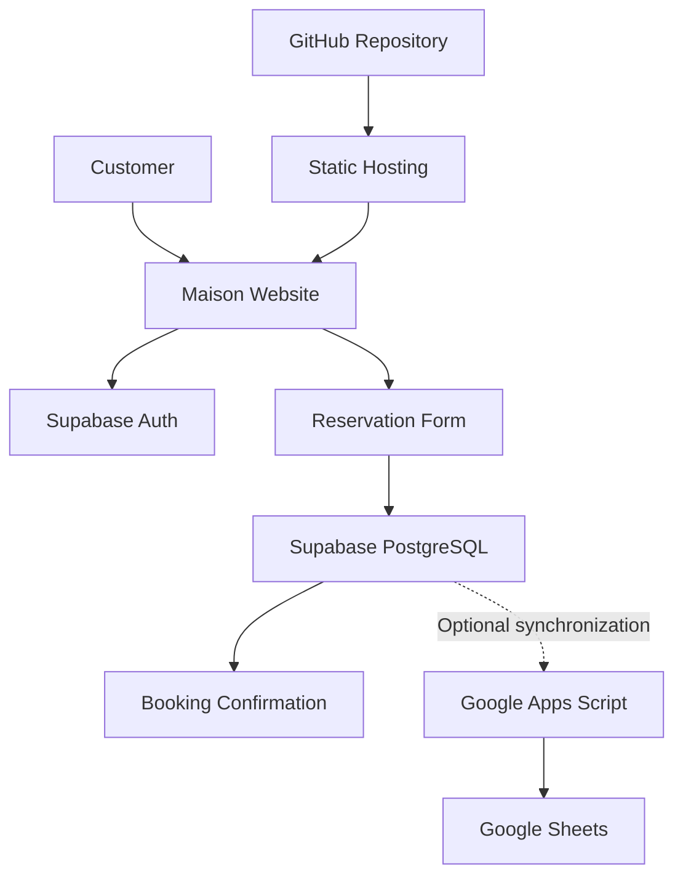

# MAISON. — Restaurant Reservations

<p align="center">
  <strong>Good food. Beautiful moments.</strong>
</p>

<p align="center">
  A premium restaurant reservation website built with HTML, CSS, JavaScript, Supabase, and Google Sheets.
</p>

<p align="center">
  
  
  
  
  
  
</p>

<p align="center">
  <a href="#-application-preview">Preview</a> •
  <a href="#-features">Features</a> •
  <a href="#-technology-stack">Tech Stack</a> •
  <a href="#-architecture">Architecture</a> •
  <a href="#-getting-started">Getting Started</a>
</p>

---

## 📖 Overview

**Maison** is a restaurant reservation web application designed to provide an elegant dining experience from the moment a customer visits the website to the moment they request a table.

The application combines a premium restaurant-inspired interface with user authentication, reservation management, and database integration.

Customers can explore the restaurant, browse featured dishes, create an account, sign in, and submit table reservation requests. Reservation records are stored in Supabase and can also be synchronized with Google Sheets through Google Apps Script.

The project is built with vanilla HTML, CSS, and JavaScript, making it lightweight, easy to understand, and straightforward to deploy.

## 📸 Application Preview

### 🏠 Homepage

The landing page introduces the Maison brand through elegant typography, a restaurant hero image, and a clear reservation call to action.

<p align="center">
  
</p>

### 🍽️ Restaurant Menu

A curated selection of featured dishes with descriptions and prices, presented in a clean, editorial-style layout.

<p align="center">
  
</p>

### 📅 Table Reservation

Customers can enter their details, choose a date and time, select the number of guests, and submit a reservation request.

<p align="center">
  
</p>

### 🗄️ Booking Database

Reservation records are stored in Supabase PostgreSQL, making it possible to inspect booking information through the database dashboard.

<p align="center">
  
</p>

---

## ✨ Features

### 🎨 User Interface
- Elegant restaurant landing page.
- Premium typography and a warm, neutral color palette.
- Restaurant introduction and featured dishes.
- Responsive reservation form.
- Navigation between website sections.

### 🔐 Authentication
- Email and password registration.
- Existing-user sign-in and sign-out.
- User session management using Supabase Auth.
- Authentication required before submitting a reservation.

### 📋 Reservation Management
- Reservation form with customer details.
- Date and time selection.
- Support for 1–6 guests.
- Unique reservation reference.
- Booking status tracking, initially set to `pending`.
- Persistent storage using Supabase PostgreSQL.

### 📊 Google Sheets Integration
- Google Apps Script integration for spreadsheet updates.
- Centralized reservation tracking in Google Sheets.
- Convenient access to booking information for restaurant management.

> Note: Browser-based `no-cors` requests cannot confirm whether Google Sheets accepted a record. Verify the spreadsheet or use a server-side integration for reliable synchronization.

### 🚀 Deployment
- Static website that can be hosted on services such as Vercel.
- Source code maintained in GitHub.
- Backend services provided by Supabase.

---

## 🛠️ Technology Stack

| Technology | Purpose |
|---|---|
| HTML5 | Website structure and forms |
| CSS3 | Styling, layouts, and responsive design |
| JavaScript | Form handling and application logic |
| Supabase Auth | User registration and authentication |
| Supabase PostgreSQL | Persistent booking storage |
| Google Apps Script | Spreadsheet integration |
| Google Sheets | Reservation tracking |
| GitHub | Source control and project hosting |
| Vercel | Static website deployment |

---

## 🏗️ Architecture



### Reservation Workflow

1. The customer opens the Maison website.
2. The customer creates an account or signs in.
3. The customer completes the reservation form.
4. JavaScript validates the submitted details.
5. Supabase stores the reservation in PostgreSQL.
6. The application displays a booking reference and the reservation status.
7. Google Apps Script can transfer booking information to Google Sheets when the integration is configured.

---

## 🗃️ Database Design

The primary database table is `public.bookings`.

| Column | Data Type | Description |
|---|---|---|
| `id` | UUID | Unique booking identifier |
| `user_id` | UUID | Authenticated user's identifier |
| `customer_name` | Text | Customer's full name |
| `email` | Text | Customer email address |
| `phone` | Text | Contact number |
| `booking_date` | Date | Requested reservation date |
| `booking_time` | Text | Requested reservation time |
| `guests` | Integer | Number of guests, from 1 to 6 |
| `status` | Text | Reservation status |
| `created_at` | Timestamptz | Record creation timestamp |

### Database Constraints

- `id` is the primary key and is generated as a UUID.
- `user_id` references `auth.users(id)`.
- Deleting an authenticated user cascades to their associated bookings under the current schema.
- `guests` must be between 1 and 6.
- `status` defaults to `pending`.
- `created_at` defaults to the current timestamp.

**Security:** Row Level Security (RLS) policies must restrict users to the records they are authorized to access. A public-facing publishable key is not a replacement for database access policies.

---

## 📁 Project Structure

```text
maison-restaurant/
│
├── index.html        # Website structure
├── style.css         # Styling and responsive layouts
├── script.js         # Authentication and reservation logic
├── README.md         # Project documentation
│
├── homepage.png      # Homepage screenshot
├── menu.png          # Menu screenshot
├── reservation.png   # Reservation form screenshot
└── bookings.png      # Supabase booking records screenshot
```

The screenshot paths above match the files uploaded to the repository root.

---

## ⚙️ Getting Started

### Prerequisites

- A modern web browser.
- Visual Studio Code or another code editor.
- A Supabase project.
- Google Sheets and Google Apps Script if spreadsheet synchronization is required.

### 1. Clone the Repository

Replace the placeholder with your actual GitHub repository URL.

```bash
git clone YOUR_GITHUB_REPOSITORY_URL
cd maison-restaurant
```

Alternatively, download the repository as a ZIP file and open the extracted folder in Visual Studio Code.

### 2. Configure Supabase

Create a Supabase project and configure the `public.bookings` table using the SQL Editor.

The frontend uses the Supabase JavaScript client loaded from a CDN. Configure the project URL and publishable key in `script.js`:

```javascript
const SUPABASE_URL = 'YOUR_SUPABASE_PROJECT_URL';
const SUPABASE_KEY = 'YOUR_SUPABASE_PUBLISHABLE_KEY';
```

Use the publishable key intended for browser applications. Never expose a Supabase secret key or `service_role` key in frontend code.

Configure authentication and Row Level Security policies before accepting real customer bookings.

### 3. Configure Google Sheets (Optional)

1. Create a Google Sheet named **Maison Restaurant Bookings**.
2. Add columns for booking ID, customer name, email, phone, booking date, booking time, guests, status, and creation timestamp.
3. Open Google Apps Script and create a script to receive booking data and append rows to the spreadsheet.
4. Deploy the script as a web app.
5. Configure its deployment URL in `script.js`.

Example configuration:

```javascript
const GOOGLE_SCRIPT_URL =
  'YOUR_GOOGLE_APPS_SCRIPT_WEB_APP_URL';
```

Use the deployed web app URL ending in `/exec`. Implement appropriate validation and access controls before processing real customer information.

### 4. Run the Website Locally

**Using Visual Studio Code:**

1. Open the project folder.
2. Install the Live Server extension if necessary.
3. Right-click `index.html`.
4. Select **Open with Live Server**.

The website should open at a local address such as `http://127.0.0.1:5500`.

No React, Vite, or other frontend build tool is required for this version.

---

## 🌐 Deployment

### Deploy with Vercel

1. Push the project to GitHub.
2. Sign in to Vercel and import the repository.
3. Configure the project as a static website.
4. Use the repository root as the project directory.
5. Deploy the application.
6. Open the generated deployment URL and test the booking workflow.

If the project uses only HTML, CSS, and JavaScript, a framework preset is not required. Configure the deployment to serve `index.html` from the root.

### Supabase Authentication Configuration

If authentication redirects or email confirmations do not work on the deployed site:

1. Open your Supabase project dashboard.
2. Navigate to **Authentication → URL Configuration**.
3. Set the production website URL as the Site URL.
4. Add the local development URL and production URL to the allowed redirect URLs when needed.
5. Test signup, email confirmation, sign-in, and sign-out.

---

## 🔒 Security Considerations

- Keep secret API keys out of browser code and GitHub.
- Use Supabase RLS policies to enforce record ownership.
- Validate booking details on the backend or through database constraints where appropriate.
- Do not treat a client-side success message as proof that a third-party integration succeeded.
- Restrict access to customer contact information.
- Review Google Apps Script deployment permissions before using real customer data.

---

## 🧪 Testing Checklist

- [ ] Homepage and navigation load correctly.
- [ ] Menu section displays all featured dishes.
- [ ] Signup works with valid details.
- [ ] Sign-in and sign-out work correctly.
- [ ] Unauthenticated users cannot submit bookings.
- [ ] Past reservation dates are rejected.
- [ ] Valid reservations are saved in Supabase.
- [ ] Booking references are displayed after successful submission.
- [ ] Reservation status defaults to `pending`.
- [ ] Google Sheets receives booking records when integration is enabled.
- [ ] The website works on desktop and mobile screens.

---

## 🔮 Future Improvements

- Restaurant administration dashboard.
- Booking approval and cancellation workflows.
- Email confirmations and reservation reminders.
- Real-time booking availability.
- Duplicate booking prevention.
- Menu images and detailed dish pages.
- Better server-side synchronization with Google Sheets.
- Automated testing and improved form validation.

---

## 👨‍💻 Author

**Sahil Chaurasia**

MCA Student | AI & ML | Software Development

<p>
  <a href="https://github.com/Wahsahil">GitHub Profile</a>
</p>

---

<p align="center">
  <strong>MAISON.</strong><br>
  Thoughtfully prepared. Beautifully remembered.
</p>
