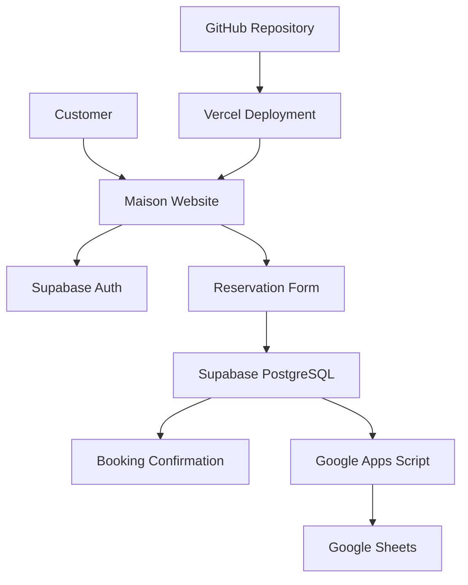

# MAISON. — Restaurant Reservations

<p align="center">
  <strong>Good food. Beautiful moments.</strong>
</p>

<p align="center">
  A premium restaurant website designed to make table reservations simple, elegant, and convenient.
</p>

<p align="center">
  
  
  
  
  
  
</p>

<p align="center">
  <a href="YOUR_VERCEL_DEPLOYMENT_URL">Live Demo</a> ·
  <a href="#features">Features</a> ·
  <a href="#getting-started">Getting Started</a> ·
  <a href="#architecture">Architecture</a>
</p>

---

## Overview

**Maison** is a modern restaurant reservation web application that combines a premium dining-inspired interface with a functional booking system.

Customers can explore the restaurant, browse featured dishes, create an account, sign in, and request a table reservation. Booking records are stored in Supabase and synchronized with Google Sheets for convenient reservation management.

The project is built using HTML, CSS, and vanilla JavaScript, keeping the application lightweight and straightforward to deploy.

## Preview

Maison features a premium restaurant experience with an elegant landing page, curated menu, and interactive table reservation form.

| Homepage & Menu | Table Reservations |
|---|---|
| Explore the restaurant and featured dishes. | Submit a reservation with your contact details, date, time, and guest count. |

**Core functionality**
- Email authentication with Supabase.
- PostgreSQL reservation storage.
- Google Sheets booking integration.
- Responsive restaurant interface.

*Replace these image paths with your screenshots. Until the files are uploaded, GitHub will display broken image links.*

## Features

### Customer Experience
- Elegant restaurant landing page with a premium visual style.
- Restaurant introduction and featured menu items.
- Reservation form with date, time, phone number, and guest selection.
- Responsive layout for different screen sizes.

### Authentication
- Email and password registration.
- Existing-user sign-in and sign-out.
- Session handling with Supabase Auth.
- Booking requests require an authenticated user.

### Reservation Management
- Saves reservations in a PostgreSQL database through Supabase.
- Records customer information, reservation date and time, guest count, and status.
- Generates a unique booking reference.
- Uses `pending` as the initial reservation status.

### Google Sheets Integration
- Sends successful booking details to Google Sheets through a Google Apps Script web app.
- Provides a spreadsheet view of customer bookings.
- Makes it easier to review reservation records without opening the database dashboard.

### Deployment
- Static website hosting through Vercel.
- Source code maintained in GitHub.
- Supabase provides authentication and database services.

## Technology Stack

| Technology | Purpose |
|---|---|
| HTML5 | Page structure and forms |
| CSS3 | Layout, styling, and responsive design |
| JavaScript | Form validation and application logic |
| Supabase Auth | User registration and authentication |
| Supabase PostgreSQL | Persistent reservation storage |
| Google Sheets | Reservation tracking and reporting |
| Google Apps Script | Transfers booking data to the spreadsheet |
| GitHub | Version control and source code |
| Vercel | Website deployment and hosting |

## Architecture



**Booking flow:** The customer signs in, submits a reservation, and the application stores the booking in Supabase. The application then sends the saved booking details to the Google Apps Script endpoint for spreadsheet recording.

The current browser-based Sheets integration uses a `no-cors` request, so the browser cannot confirm whether Google Sheets accepted the record. Verify synchronization in the spreadsheet itself.

## Database Design

The main database table is `public.bookings`.

| Column | Type | Description |
|---|---|---|
| `id` | UUID | Unique reservation identifier |
| `user_id` | UUID | Reference to the authenticated user |
| `customer_name` | Text | Customer's full name |
| `email` | Text | Customer email |
| `phone` | Text | Contact number |
| `booking_date` | Date | Requested reservation date |
| `booking_time` | Text | Requested reservation time |
| `guests` | Integer | Number of guests, from 1 to 6 |
| `status` | Text | Reservation status, initially `pending` |
| `created_at` | Timestamptz | Record creation timestamp |

The `user_id` references `auth.users(id)`, and the record identifier is generated using a UUID.

## Project Structure

```text
maison-restaurant/
├── index.html       # Restaurant website structure
├── style.css        # Styling and responsive layout
├── script.js        # Authentication and booking logic
├── README.md        # Project documentation
└── screenshots/
    ├── homepage.png
    ├── menu.png
    ├── reservation.png
    └── bookings.png
```

The `screenshots/` directory is optional; create it when adding the actual application screenshots.

## Getting Started

### Prerequisites

- A modern web browser.
- A code editor such as Visual Studio Code.
- A Supabase project.
- A Google Sheet and a deployed Google Apps Script web app.

### 1. Clone the repository

```bash
git clone YOUR_GITHUB_REPOSITORY_URL
cd maison-restaurant
```

Alternatively, download the repository as a ZIP file and extract it.

### 2. Configure Supabase

Create a Supabase project and execute the SQL needed to create the `bookings` table.

Configure Row Level Security (RLS) policies so authenticated users can create bookings only for their own user ID, and can access only the records they are authorized to access.

Add your Supabase project URL and publishable key to `script.js`:

```javascript
const SUPABASE_URL = 'YOUR_SUPABASE_PROJECT_URL';
const SUPABASE_KEY = 'YOUR_SUPABASE_PUBLISHABLE_KEY';
```

The publishable key is intended for browser applications; database access must still be protected by correctly configured RLS policies.

### 3. Configure Google Sheets

1. Create a Google Sheet for restaurant bookings.
2. Add columns for booking ID, customer name, email, phone, booking date, booking time, guests, status, and creation timestamp.
3. Create a Google Apps Script that accepts incoming booking data and appends it to the sheet.
4. Deploy the script as a web app with the appropriate access settings.
5. Configure the deployed `/exec` URL in `script.js`.

```javascript
const GOOGLE_SCRIPT_URL = 'YOUR_GOOGLE_APPS_SCRIPT_WEB_APP_URL';
```

Use appropriate validation and access controls before handling real customer information.

### 4. Run locally

Open the project folder in Visual Studio Code and launch `index.html` using the Live Server extension.

Alternatively, use any static local HTTP server.

Test registration, sign-in, reservation submission, and the resulting records in Supabase and Google Sheets.

## Deployment

### Deploy using Vercel

1. Push the project to GitHub.
2. Sign in to Vercel
